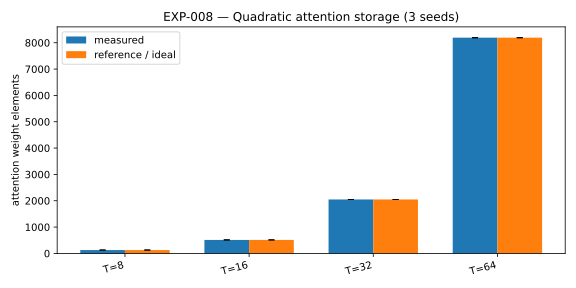

# Transformer From Scratch — AIR-005

**Status:** educational forward-pass implementation locally verified; scientific audit and hosted CI pending.

NumPy token embeddings, sinusoidal positions, scaled dot-product and multi-head self-attention, boolean masking, layer normalization, residual connections and a post-norm ReLU transformer block. Causal masking supports decoder-style self-attention, not a complete encoder-decoder or language model. PyTorch is used only in reference tests and experiments. Complements [AIR-004](https://github.com/MarkRizam/deep-learning-from-scratch) and [RizamLearning](https://github.com/MarkRizam/RizamLearning).

## Reproduce
Python 3.13, virtual environment, CPU only. For PowerShell: `$env:OPENBLAS_NUM_THREADS='1'`; `$env:OMP_NUM_THREADS='1'`. Bash: `export OPENBLAS_NUM_THREADS=1 OMP_NUM_THREADS=1`.

```sh
python -m pip install torch==2.10.0 --index-url https://download.pytorch.org/whl/cpu
python -m pip install numpy==2.3.5 -e ".[research]"
python -m pytest -q
python scripts/verify_committed_results.py
python -m transformer_scratch.experiments
python scripts/notebooks.py
```

## Evidence
8 experiments, 21 configurations, 63 records, 34 local passing tests and 8 executed notebooks. See [protocol](research/protocol.md), [report](research/report.md), [raw results](results/benchmarks.json) and [limitations](research/limitations.md). True in masks means allowed; padding masks suppress keys, not queries. Fully masked attention rows return zero weights/output; residual block output need not be zero. Attention storage counts only the weight tensor, not total memory or elapsed time.



MIT for original software; dependencies retain their own licenses. Not a production model or peer-reviewed research. No external dataset, trained model, GPU or paid API.
